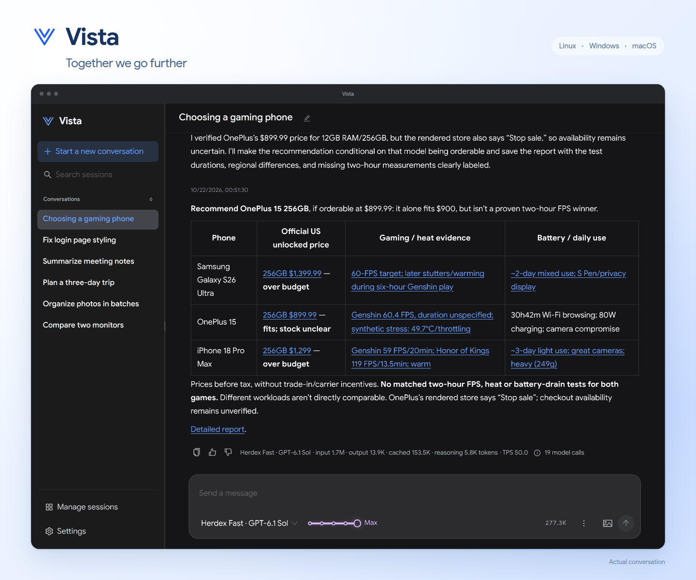

# Vista

[简体中文](./README.zh-CN.md)



Vista is a general-purpose agent for Linux, Windows, and macOS. Describe a goal in its browser interface and let the agent use files, shell commands, web queries, MCP tools, and skills to complete the work. Each open conversation has its own Worker process; conversations and their history are stored where Vista runs.

## Getting started

Download the archive for your system from [GitHub Releases](https://github.com/willvar/vista/releases/latest) and extract it.

Run `vista`; on Windows, you can also double-click `vista.exe`. It starts the service in the background and opens the default browser. Opening it again uses the running instance. The default address is `http://127.0.0.1:5186/`.

On Windows, the running service has a notification-area icon. Click or double-click it to open Vista; right-click for Restart, Status, and Stop. Status opens a native window with service, conversation, process, memory, and build information. Stop removes the icon along with stopping the service.

Connect a model provider in Settings before sending the first message. Built-in connections provide their authentication and protocol settings; custom connections let you choose the conversation API format and authentication independently. Model availability follows the connected account or service.

| Command | Action |
| --- | --- |
| `vista` / `vista start` | Start the service or open the existing instance |
| `vista status` | Show service, conversation, Worker, and process status |
| `vista stop` | Stop the service and its managed work, keeping history |
| `vista restart` | Stop and start the service, keeping history |

Closing the browser does not stop work. Closing a conversation stops its Worker and managed background work, while retaining its history; deleting it also removes its associated data. Restarting Vista records unfinished operations as interrupted and does not replay their side effects.

To choose a persistent port, set `{"port":6186}` in `<configuration root>/server.json`. `VISTA_PORT` overrides that file, and `--port` on startup or restart overrides both. Ports must be 1–65535; Vista does not silently switch to another port. The change applies at the next start.

## Build from source

Building requires Go 1.26+, Node.js with native TypeScript support, npm, and Make. From the repository root:

```sh
make build
./bin/vista start
```

`make build` builds and embeds the frontend. Development builds use version `dev`; use `make build VERSION=v0.1.0` for a release version. Release builds first refresh the bundled [client UA versions](./docs/providers.md#http-client-identity). About Vista shows the version, executable SHA-256, source commit, and host operating system. Builds do not inject a timestamp.

After `make web`, cross-compile the executable with:

```sh
GOWORK=off CGO_ENABLED=0 GOOS=windows GOARCH=amd64 go build -o bin/vista-windows-amd64.exe ./cmd/vista
GOWORK=off CGO_ENABLED=0 GOOS=darwin GOARCH=arm64 go build -o bin/vista-darwin-arm64 ./cmd/vista
GOWORK=off CGO_ENABLED=0 GOOS=darwin GOARCH=amd64 go build -o bin/vista-darwin-amd64 ./cmd/vista
```

Shell tools use Windows PowerShell on Windows and `/bin/sh` on Linux/macOS. Running Vista does not require a separate shell or database installation.

## Configuration and state directories

All platforms use Go's `os.UserConfigDir()` to locate the Vista configuration root. Runtime state lives in its `state/` child directory.

| Platform | Configuration root |
| --- | --- |
| Linux | `$XDG_CONFIG_HOME/vista`, or `~/.config/vista` when unset |
| Windows | `%APPDATA%/vista` |
| macOS | `~/Library/Application Support/vista` |

The root holds model and MCP connections, the user-editable global `AGENTS.md`, `skills/`, and account credentials. SQLite, instance records, locks, logs, output artifacts, and shared resource originals live under `state/`.

Settings manages provider connections, web query services, MCP, global instructions, memory, skills, and resource storage. Place skill folders containing `SKILL.md` in the displayed skills directory and refresh. Project-specific instructions can be placed in an `AGENTS.md` in the relevant folder; they apply to that folder and its descendants.

## Conversations and resources

Conversations have no fixed working directory. Provide relevant paths in the task. Different conversations share the real filesystem: editing or withdrawing a message rolls back conversation context only, keeping file changes and other tool side effects.

Attachments are stored as shared, content-addressed originals, with conversation-owned references rather than binary content in SQLite. New images enter the next request when the model supports them; later requests retain references until the model explicitly reads an original again. Closing a conversation retains its resources. Deleting the last owning conversation makes an original eligible for manual cleanup in Settings.

Automatic context compaction follows explicit upstream context-overflow evidence, then retries the failed model request without replaying completed tools. Manual compaction is available while idle and does not send a message or resume work automatically. Model catalog limits do not trigger compaction.

## Development and verification

Development rules and commit conventions are in [AGENTS.md](./AGENTS.md). Direct Go commands use `GOWORK=off`. Select checks from the repository root:

```sh
make test go
make test frontend
make test e2e
make test integration
make test mcp
make test memory
make test capacity
make test all
```

| Goal | Checks |
| --- | --- |
| `go` | Go tests, vet, and the race detector |
| `frontend` | Frontend unit tests, type checking, and production asset build |
| `e2e` | Playwright on desktop, mobile portrait, and mobile landscape |
| `integration` | CLI/Server/Worker workflows, tool continuation, compaction, persistence, file-write conflicts, SQLite faults, and crashes |
| `mcp` | SDK fixtures over stdio/HTTP and pinned upstream Filesystem/Everything servers |
| `memory` | 20 open conversations and 200 repeated turns in one Worker with memory regression gates |
| `capacity` | Mixed shell/MCP/subagent load, Chat/Responses long output, slow SSE readers, and images over eight adapters |
| `all` | All seven goals, in sequence; stops on the first failure |

`make test` defaults to `go`; combine goals with `make test frontend memory`. Shared prerequisites run once. Checks install locked dependencies as needed. Browser tests find Chrome/Chromium on `PATH`, or use `VISTA_CHROME`; integration checks require `sqlite3`. Missing prerequisites fail explicitly.

Tests build isolated executables under `.vista/test-state/bin` and use separate configurations, ports, and browser profiles. They do not replace `bin/vista` or restart the user's instance. Prerequisites and test environments are described in [verification](./docs/testing.md).

## Documentation

- [Product scope and audience](./docs/product.md)
- [Architecture and runtime contracts](./docs/architecture.md)
- [Provider routing and model metadata](./docs/providers.md)
- [Worker and background process lifecycle](./docs/process-lifecycle.md)
- [Test goals and capacity measurement](./docs/testing.md)
- [Frontend, internationalization, and browser checks](./web/README.md)
- [Context compaction](./docs/context-compaction.md), [resources](./docs/resources.md), and [conversation rollback](./docs/message-revert.md)

## License

Vista's original code and documentation are licensed under the [MIT License](./LICENSE). Third-party components retain their own licenses and copyrights; the complete [license and attribution notices](./licenses/NOTICE) are included in distribution archives and available at `/licenses` on the running service.
