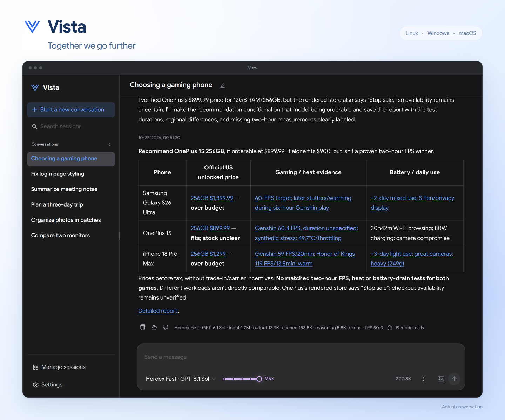

# Vista

[简体中文](./README.zh-CN.md)



Vista is a general-purpose agent for Linux, Windows, and macOS. Describe a goal in its browser interface and let the agent use files, shell commands, web queries, MCP tools, and skills to complete the work. Each open conversation has its own Worker process; conversations and their history are stored where Vista runs.

## Getting started

Download the archive for your system from [GitHub Releases](https://github.com/willvar/vista/releases/latest) and extract it.
Linux, Windows, and macOS each provide x86-64 (`amd64`) and ARM64 (`arm64`) archives.

Run `vista`; on Windows, you can also double-click `vista.exe`. It starts the service in the background and opens the default browser. Opening it again uses the running instance. The default address is `http://127.0.0.1:5186/`.

On Windows, the running service has a notification-area icon. Click or double-click it to open Vista; right-click for Restart, Status, and Stop. Status opens a native window with service, conversation, process, memory, and build information. Stop removes the icon along with stopping the service.

Connect a model provider in Settings before sending the first message. Built-in connections provide their authentication and protocol settings; custom connections let you choose the conversation API format and authentication independently. Model availability follows the connected account or service.

| Command | Action |
| --- | --- |
| `vista` / `vista start` | Start the service or open the existing instance |
| `vista status` | Show service, conversation, Worker, and process status |
| `vista stop` | Stop the service and its managed work, keeping history |
| `vista restart` | Stop and start the service, keeping history |

Closing the browser does not stop work. Closing a conversation stops its Worker and managed background work, while retaining its history; deleting it also removes its associated data. Restarting Vista records unfinished operations as interrupted and does not replay their side effects.

About Vista → Restart Vista always asks for confirmation and restarts the Server process through the CLI restart flow, keeping data, browser drafts, the configuration directory and current listening port without opening another browser. It loads the current binary at the same executable path; running tasks and managed background processes are interrupted, not automatically resumed or replayed. See [service controls](./docs/product.md#about-vista-and-service-controls).

Choose a persistent port in About Vista → Service configuration. The form accepts an integer from 1 to 65535 and saves it to the `server` section of `config.json`. Changing the running port requires confirmation: Vista reserves the target port before saving and restarting, then offers a link to the new address. If the port cannot be reserved, the running service and saved configuration are kept.

Saving the current port does not restart Vista. The separate Restart Vista action also keeps the current listening port. On an ordinary start, `--port` takes precedence over `VISTA_PORT`, followed by the saved port and the default. Vista does not silently switch to another port.

## Build from source

Building requires Go 1.26+, Node.js with native TypeScript support, npm, and Make. From the repository root:

```sh
make build
./bin/vista start
```

`make build` builds and embeds the frontend. Development builds use version `dev`; use `make build VERSION=v0.1.0` for a release version. Release builds first refresh the bundled [client UA versions](./docs/providers.md#http-client-identity). About Vista shows the version, executable SHA-256, source commit, and host operating system. Builds do not inject a timestamp.

After `make web`, cross-compile the executable with:

```sh
GOWORK=off CGO_ENABLED=0 GOOS=linux GOARCH=arm64 go build -o bin/vista-linux-arm64 ./cmd/vista
GOWORK=off CGO_ENABLED=0 GOOS=windows GOARCH=amd64 go build -o bin/vista-windows-amd64.exe ./cmd/vista
GOWORK=off CGO_ENABLED=0 GOOS=windows GOARCH=arm64 go build -o bin/vista-windows-arm64.exe ./cmd/vista
GOWORK=off CGO_ENABLED=0 GOOS=darwin GOARCH=arm64 go build -o bin/vista-darwin-arm64 ./cmd/vista
GOWORK=off CGO_ENABLED=0 GOOS=darwin GOARCH=amd64 go build -o bin/vista-darwin-amd64 ./cmd/vista
```

Shell tools use Windows PowerShell on Windows and `/bin/sh` on Linux/macOS. Running Vista does not require a separate shell or database installation.

## Configuration and state directories

All platforms use Go's `os.UserConfigDir()` to locate the Vista configuration root. Runtime state lives in its `state/` child directory.

| Platform | Configuration root |
| --- | --- |
| Linux | `$XDG_CONFIG_HOME/vista`, or `~/.config/vista` when unset |
| Windows | `%APPDATA%/vista` |
| macOS | `~/Library/Application Support/vista` |

The root holds the main `config.json`, static credentials in `key.json`, the user-editable global `AGENTS.md`, `skills/`, generated model catalogs, and separate account authorization directories. SQLite, instance records, locks, logs, output artifacts, and shared resource originals live under `state/`.

There are three fixed user configuration filenames: the main `config.json`, static-credential `key.json`, and optional global `AGENTS.md`. The main JSON requires integer `version: 2` and has seven optional sections: `server`, `capacity`, `agent`, `search`, `userAgent`, `models`, and `mcp`. Static model, MCP and search credentials, including entire custom `headers` objects, are stored in `key.json` (`version: 1`); managed records or the search object use opaque `credentialRef` references. Missing sections keep their existing defaults or environment fallback; explicit empty and `null` values retain their typed meaning. Generated `omp-models.json` and `model-catalog-status.json`, per-account authorizations, skills, runtime state, and browser preferences stay outside this count; see [configuration editing](./docs/product.md#configuration-editing) for the field boundaries and migration table.

Both JSON files are private (`0600` in a `0700` configuration root where Unix permissions apply). This is file isolation only: `key.json` remains plaintext, without encryption, a system keyring or cloud KMS, and offers no security boundary against processes running as the same user. Public client IDs, routing and identity settings stay in the main file, which may still reveal internal addresses and project/account identifiers; it is not automatically safe to share publicly. SDK OAuth accounts, refresh tokens and login directories stay separate; authorization behavior is unchanged.

One-time conversion runs only at Vista Server startup, after acquiring the instance lock and before loading settings. It accepts the seven legacy JSON files when `config.json` is absent, or upgrades the previous inline-credential `config.json` v1. It validates and prepares the conversion, verifies exact private backups with `SHA256SUMS` of the actual source files (including v1 `config.json` and an existing `key.json` as applicable), then publishes keys before the main file. Only after verifying the published pair and required durability does it remove unchanged legacy source originals. The private backup is retained; `AGENTS.md` and account authorization data are untouched, and old identities are never automatically restored.

Once a current main file is present, later starts only validate the current format and referenced keys: healthy starts do not scan legacy paths, import old data or create another migration backup. An existing main file is the sole source; leftover old files are ignored, even for missing sections, and backups are not automatically restored. Invalid main files or broken/missing credential references fail closed, without reimporting old data or automatically resetting settings. Older binaries must use a different configuration directory, not the migrated one.

Normal reads and writes use only the current `config.json` and `key.json`, without legacy data or credential fallback. Libraries and first writes do not convert old state: normal access to old or unmigrated data reports “start Vista to migrate” instead of copying old values. An explicit write in a fresh empty root may initialize the current files; that is initialization, not migration.

Settings and About Vista use schema-validated forms with explicit saving. Invalid values block saving. The forms expose the relevant setting fields; static credentials use separate write-only inputs, while authorization and provider workflows retain their own controls. Typed settings APIs resolve private credentials internally and preserve their existing masking, blank-to-reuse and explicit-clear semantics. Saves keep their existing runtime effects; editing files directly does not add global hot reload. The shared configuration lock orders credential publication before main-file references and prunes only previously active references dropped by that committed update; two file replacements are not a single atomic transaction. See [configuration storage](./docs/architecture.md#unified-configuration-storage) for ordering, read and reload boundaries.

Settings manages provider connections, web query services, MCP, global instructions, memory, skills, and resource storage. Place skill folders containing `SKILL.md` in the displayed skills directory and refresh. Project-specific instructions can be placed in an `AGENTS.md` in the relevant folder; they apply to that folder and its descendants.

## Conversations and resources

Conversations have no fixed working directory. Provide relevant paths in the task. Different conversations share the real filesystem: editing or withdrawing a message rolls back conversation context only, keeping file changes and other tool side effects.

Attachments are stored as shared, content-addressed originals, with conversation-owned references rather than binary content in SQLite. New images enter the next request when the model supports them; later requests retain references until the model explicitly reads an original again. Closing a conversation retains its resources. Deleting the last owning conversation makes an original eligible for manual cleanup in Settings.

Automatic context compaction follows explicit upstream context-overflow evidence, then retries the failed model request without replaying completed tools. Manual compaction is available while idle and does not send a message or resume work automatically. Model catalog limits do not trigger compaction.

## Development and verification

Development rules and commit conventions are in [AGENTS.md](./AGENTS.md). Direct Go commands use `GOWORK=off`. Select checks from the repository root:

```sh
make test go
make test frontend
make test e2e
make test integration
make test mcp
make test memory
make test capacity
make test all
```

| Goal | Checks |
| --- | --- |
| `go` | Go tests, vet, and the race detector |
| `frontend` | Frontend unit tests, type checking, and production asset build |
| `e2e` | Playwright on desktop, mobile portrait, and mobile landscape |
| `integration` | CLI/Server/Worker workflows, tool continuation, compaction, persistence, file-write conflicts, SQLite faults, and crashes |
| `mcp` | SDK fixtures over stdio/HTTP and pinned upstream Filesystem/Everything servers |
| `memory` | 20 open conversations and 200 repeated turns in one Worker with memory regression gates |
| `capacity` | Mixed shell/MCP/subagent load, Chat/Responses long output, slow SSE readers, and images over eight adapters |
| `all` | All seven goals, in sequence; stops on the first failure |

`make test` defaults to `go`; combine goals with `make test frontend memory`. Shared prerequisites run once. Checks install locked dependencies as needed. Browser tests find Chrome/Chromium on `PATH`, or use `VISTA_CHROME`; integration checks require `sqlite3`. Missing prerequisites fail explicitly.

Tests build isolated executables under `.vista/test-state/bin` and use separate configurations, ports, and browser profiles. They do not replace `bin/vista` or restart the user's instance. Prerequisites and test environments are described in [verification](./docs/testing.md).

## Documentation

- [Product scope and audience](./docs/product.md)
- [Architecture and runtime contracts](./docs/architecture.md)
- [Provider routing and model metadata](./docs/providers.md)
- [Worker and background process lifecycle](./docs/process-lifecycle.md)
- [Test goals and capacity measurement](./docs/testing.md)
- [Benchmarks: setup and results](./docs/benchmarks.md)
- [Frontend, internationalization, and browser checks](./web/README.md)
- [Context compaction](./docs/context-compaction.md), [resources](./docs/resources.md), and [conversation rollback](./docs/message-revert.md)

## License

Vista's original code and documentation are licensed under the [MIT License](./LICENSE). Third-party components retain their own licenses and copyrights; the complete [license and attribution notices](./licenses/NOTICE) are included in distribution archives and available at `/licenses` on the running service.
