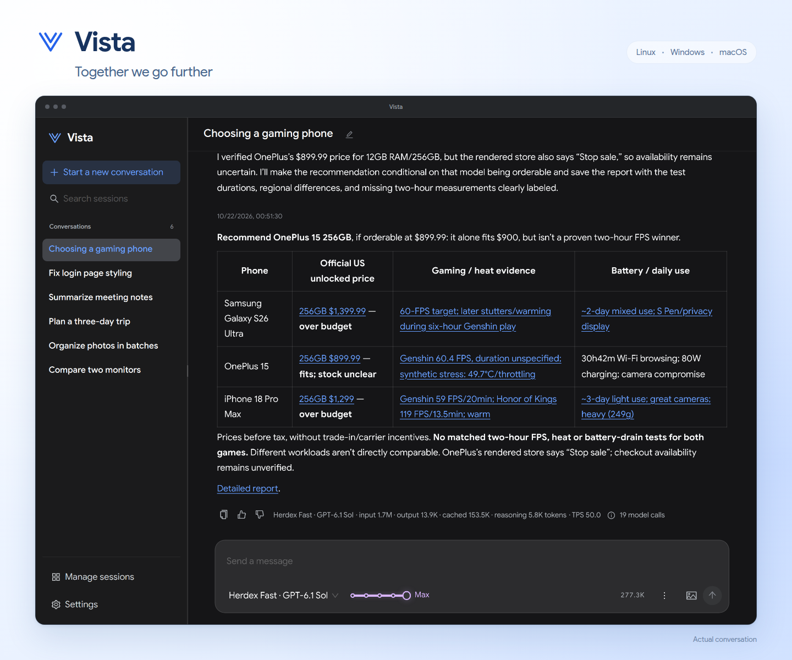

# Vista

[简体中文](./README.zh-CN.md)



Vista is a general-purpose agent for Linux, Windows, and macOS. Describe a goal in its browser interface and let the agent use files, shell commands, web queries, MCP tools, and skills to complete the work. Each open conversation has its own Worker process; conversations and their history are stored where Vista runs.

## Getting started

Choose an archive for your operating system and architecture on [GitHub Releases](https://github.com/willvar/vista/releases/latest).
Every package has one Vista executable with the service, WebUI, CLI, native window and tray. Double-click `vista` (`vista.exe` on Windows, `Vista.app` on macOS) to open the [desktop window](./docs/desktop.md). With a tray available, closing the window hides it and leaves the service running.

| Command | What it does |
| --- | --- |
| `vista` | Start or reuse the service and open the desktop |
| `vista web` | Start or reuse the service and open the default browser |
| `vista serve` | Run the service in the foreground without opening an interface |
| `vista status` | Show the service state without starting it |
| `vista stop` / `vista restart` | Stop or restart the service, keeping history |
| `vista --help` | Show command help |

On macOS, the command-line executable is `Vista.app/Contents/MacOS/vista`. If opening the browser fails, `vista web` still prints the address. Desktop and browser launches bind a new service to loopback by default; reusing a service keeps its listener. Standalone `vista serve` continues to listen on IPv4 interfaces unless `VISTA_HOST` restricts it; configure HTTPS with a reverse proxy.

**When upgrading:** configuration and conversations stay in place. The old no-argument browser launch is now `vista web`; use `vista serve` for a foreground service.

Connect a model provider in Settings before sending the first message. Supported models depend on the connected service and account.

Closing the browser does not stop work. Closing a conversation stops its Worker and managed background work, while retaining its history; deleting it also removes its associated data. Restarting Vista records unfinished operations as interrupted and does not replay their side effects.

About Vista provides service restart and port settings. Restart keeps conversations and the current port, then continues unfinished agent tasks from saved context; managed background processes stop. See [service controls](./docs/product.md#about-vista-and-service-controls) for details.

## Build from source

Building requires Go 1.26+, Node.js with native TypeScript support, npm, and Make. From the repository root:

```sh
make build
./bin/vista web
```

`make build` builds and embeds the frontend with version `dev`; use `make build VERSION=v0.1.0` for a release version. Development rules are in [AGENTS.md](./AGENTS.md); build checks and test commands are in [verification](./docs/testing.md).

For a desktop window that uses the same interface, see the [Wails desktop build](./docs/desktop.md).

## Configuration and state directories

Settings manages service connections, model web access, MCP, global instructions, skills, and resource storage.

Configuration and conversations are stored under these directories, with runtime data in `state/`:

| Platform | Configuration root |
| --- | --- |
| Linux | `$XDG_CONFIG_HOME/vista`, or `~/.config/vista` when unset |
| Windows | `%APPDATA%/vista` |
| macOS | `~/Library/Application Support/vista` |

The directory includes settings, plaintext credentials, global `AGENTS.md` instructions, and skills. Keep it private. See [configuration editing](./docs/product.md#configuration-editing) for file formats and upgrades, and [configuration storage](./docs/architecture.md#unified-configuration-storage) for technical contracts.

## Conversations and resources

Conversations have no fixed working directory. Provide relevant paths in the task. Different conversations share the real filesystem: editing or withdrawing a message rolls back conversation context only, keeping file changes and other tool side effects.

Closing a conversation keeps its attachments. After deleting the last conversation that uses an attachment, its original file becomes eligible for manual cleanup in Settings. See [resources](./docs/resources.md).

Vista can compact long conversations automatically after a model reports a context limit, or manually while idle. See [context compaction](./docs/context-compaction.md).

## Documentation

- [Product scope and audience](./docs/product.md)
- [Architecture and runtime contracts](./docs/architecture.md)
- [Provider routing and model metadata](./docs/providers.md)
- Advanced configuration: [network and proxies](./docs/network.md), [prompt caching](./docs/prompt-caching.md)
- [Worker and background process lifecycle](./docs/process-lifecycle.md)
- [Test goals and capacity measurement](./docs/testing.md)
- [Benchmarks: setup and results](./docs/benchmarks.md)
- [Frontend, internationalization, and browser checks](./web/README.md)
- [Context compaction](./docs/context-compaction.md), [resources](./docs/resources.md), and [conversation rollback](./docs/message-revert.md)

## License

Vista's original code and documentation are licensed under the [MIT License](./LICENSE). Third-party components retain their own licenses and copyrights; the complete [license and attribution notices](./licenses/NOTICE) are included in distribution archives and available at `/licenses` on the running service.
