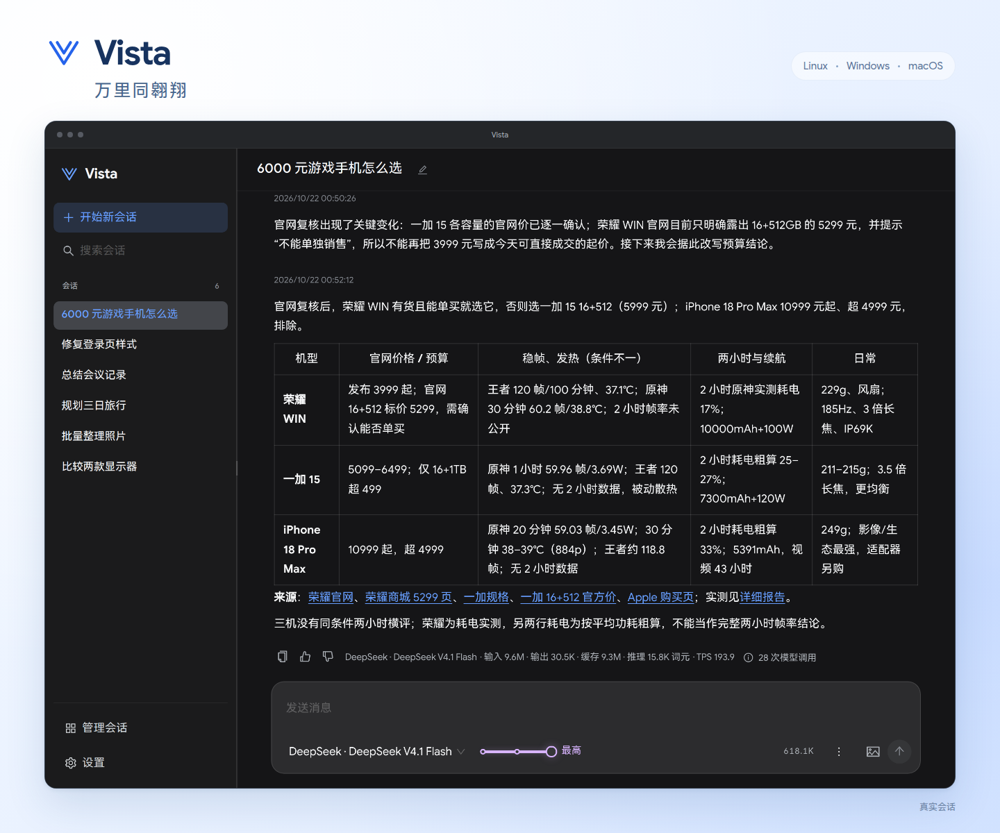

# Vista

[English](./README.md)



Vista 是适用于 Linux、Windows 和 macOS 的通用型智能体。在浏览器界面描述目标，智能体可使用文件、shell 命令、网络查询、MCP 工具及技能完成工作。每个已打开的会话拥有独立的 Worker 进程，会话和历史保存在 Vista 的运行环境中。

## 开始使用

从 [GitHub Releases](https://github.com/willvar/vista/releases/latest) 选择与系统和架构匹配的一种包。
每种安装包只有一个 Vista 可执行文件，自带服务、WebUI、CLI、原生窗口和托盘。双击 `vista`（Windows 上是 `vista.exe`，macOS 上打开 `Vista.app`）即可打开[桌面窗口](./docs/desktop.zh-CN.md)。托盘可用时关窗只隐藏，服务继续运行。

| 命令 | 作用 |
| --- | --- |
| `vista` | 启动或复用服务，打开桌面窗口 |
| `vista web` | 启动或复用服务，打开默认浏览器 |
| `vista serve` | 前台运行服务，不打开任何界面 |
| `vista status` | 查询服务状态，不启动服务 |
| `vista stop` / `vista restart` | 停止或重启服务，保留历史 |
| `vista --help` | 查看命令帮助 |

macOS 上的命令行入口是 `Vista.app/Contents/MacOS/vista`。浏览器打不开时，`vista web` 仍会打印访问地址。桌面与浏览器入口默认将新服务绑定到回环地址；复用服务不改变现有监听地址。独立运行 `vista serve` 时仍默认监听 IPv4 网卡，可用 `VISTA_HOST` 限制地址；HTTPS 由反向代理提供。

**升级时：**原有配置和会话历史继续沿用。以前不带参数打开浏览器的用法，改为 `vista web`；前台运行服务用 `vista serve`。

发送第一条消息前，在设置里连接模型服务商。可用模型取决于连接的服务及账号。

关闭浏览器不会停止工作。关闭会话会停止其 Worker 和受管后台工作，保留历史；删除会话还会移除所属数据。重启 Vista 后，未完成操作记录为中断，不自动重放其副作用。

「关于 Vista」提供服务重启和端口设置。重启保留会话和当前端口，随后根据已保存的上下文继续未完成的智能体任务；托管后台进程会停止。详情见[服务控制](./docs/product.zh-CN.md#关于-vista-与服务控制)。

## 从源码构建

构建需要 Go 1.26+、支持直接运行 TypeScript 的 Node.js、npm 和 Make。在仓库根目录执行：

```sh
make build
./bin/vista web
```

`make build` 会构建并内嵌前端，版本号默认为 `dev`；发布版本使用 `make build VERSION=v0.1.0`。开发约束见 [AGENTS.md](./AGENTS.md)，构建检查与测试命令见[验证](./docs/testing.zh-CN.md)。

如需在桌面窗口中使用同一套界面，参见 [Wails 桌面构建](./docs/desktop.zh-CN.md)。

## 配置与状态目录

设置中可管理服务连接、模型联网、MCP、全局提示词、技能和资源占用。

配置与会话保存在以下目录，运行数据位于其中的 `state/` 子目录：

| 平台 | 配置根目录 |
| --- | --- |
| Linux | `$XDG_CONFIG_HOME/vista`，未设置时为 `~/.config/vista` |
| Windows | `%APPDATA%/vista` |
| macOS | `~/Library/Application Support/vista` |

目录中包含设置、明文凭据、全局 `AGENTS.md` 提示词及技能，请妥善保管。文件格式与升级行为见[配置编辑](./docs/product.zh-CN.md#配置编辑)，技术约定见[配置存储](./docs/architecture.zh-CN.md#统一配置存储)。

## 会话与资源

会话没有固定工作目录，请在任务中提供相关路径。不同会话共享真实文件系统：编辑或撤回消息仅回退会话上下文，文件改动及其他工具副作用保留。

关闭会话会保留附件。删除最后一个使用某附件的会话后，可在设置中手动清理其原件。见[资源](./docs/resources.zh-CN.md)。

模型报告上下文超限后，Vista 可自动压缩长会话；空闲时也可手动压缩。见[上下文压缩](./docs/context-compaction.zh-CN.md)。

## 文档

- [产品范围与受众](./docs/product.zh-CN.md)
- [架构与运行时约定](./docs/architecture.zh-CN.md)
- [服务商路由与模型资料](./docs/providers.zh-CN.md)
- 高级配置：[网络与代理](./docs/network.zh-CN.md)、[提示词缓存](./docs/prompt-caching.zh-CN.md)
- [Worker 与后台进程生命周期](./docs/process-lifecycle.zh-CN.md)
- [测试目标与容量测量](./docs/testing.zh-CN.md)
- [评测：运行方法与结果](./docs/benchmarks.zh-CN.md)
- [前端、国际化与浏览器检查](./web/README.zh-CN.md)
- [上下文压缩](./docs/context-compaction.zh-CN.md)、[资源](./docs/resources.zh-CN.md)及[会话回退](./docs/message-revert.zh-CN.md)

## 许可证

Vista 的原创代码和文档采用 [MIT 许可证](./LICENSE)。第三方组件保留各自的许可证和版权声明；完整的[许可及署名声明](./licenses/NOTICE)随发布压缩包提供，也可通过运行中服务的 `/licenses` 地址查看。
