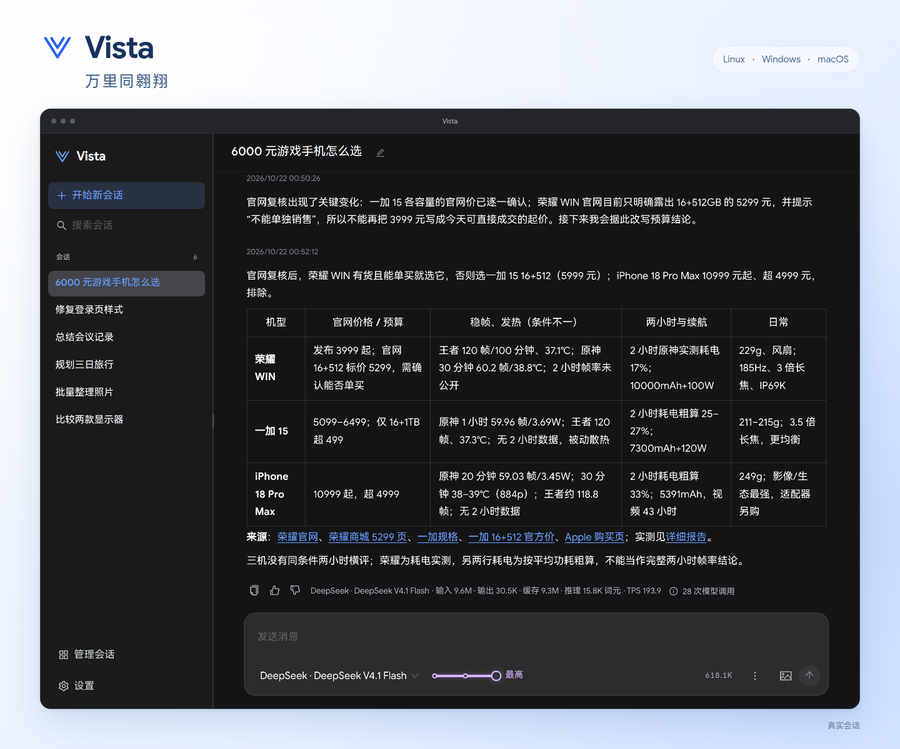

# Vista

[English](./README.md)



Vista 是适用于 Linux、Windows 和 macOS 的通用型智能体。在浏览器界面描述目标，智能体可使用文件、shell 命令、网络查询、MCP 工具及技能完成工作。每个已打开的会话拥有独立的 Worker 进程，会话和历史保存在 Vista 的运行环境中。

## 开始使用

从 [GitHub Releases](https://github.com/willvar/vista/releases/latest) 下载适合当前系统的压缩包并解压。
Linux、Windows 和 macOS 均提供 x86-64（`amd64`）与 ARM64（`arm64`）版本。

运行 `vista`；Windows 也可以直接双击 `vista.exe`。它会在后台启动服务并打开默认浏览器，再次打开会复用已运行的实例。浏览器默认打开 `http://127.0.0.1:5186/`，服务则监听所有 IPv4 网卡（`0.0.0.0`），其他设备使用 `http://<主机IP>:5186/` 访问。可选环境变量 `VISTA_HOST` 可设为某个 IPv4 地址以收窄监听范围；HTTPS 由反向代理提供，Vista 自身不处理。

Windows 服务运行时会显示托盘图标，单击或双击可打开 Vista；右键提供 Restart（重启）、Status（状态）和 Stop（停止）。Status 通过原生窗口展示服务、会话、进程、内存及构建信息。Stop 停止服务并移除图标。

发送第一条消息前，先在设置中连接模型服务商。内置连接封装认证和协议配置；自定义连接可独立选择对话 API 格式与认证方式。可用模型由所连接的账号或服务决定。

| 命令 | 作用 |
| --- | --- |
| `vista` / `vista start` | 启动服务或打开现有实例 |
| `vista status` | 查看服务、会话、Worker 和进程状态 |
| `vista stop` | 停止服务及其受管工作，保留历史 |
| `vista restart` | 停止并重新启动服务，保留历史 |

关闭浏览器不会停止工作。关闭会话会停止其 Worker 和受管后台工作，保留历史；删除会话还会移除所属数据。重启 Vista 后，未完成操作记录为中断，不自动重放其副作用。

「关于 Vista → 重启 Vista」始终要求二次确认，复用 CLI 重启流程重新启动 Server 进程，保留数据、浏览器草稿、配置目录和当前监听端口，不额外打开浏览器。重启加载同一可执行文件路径的当前版本；正在执行的任务和托管后台进程会中断，不自动恢复或重放。见[服务控制](./docs/product.zh-CN.md#关于-vista-与服务控制)。

要固定使用其他端口，在「关于 Vista → 服务配置」中设置 1 到 65535 的整数，保存到 `config.json` 的 `server` 分区。更改当前监听端口需要二次确认：Vista 先预占目标端口，再保存并重启，随后提供新地址入口。无法预占端口时，保留当前服务和已保存配置。

保存当前端口不会重启 Vista。独立的「重启 Vista」操作也会保留当前监听端口。普通启动时，`--port` 优先于 `VISTA_PORT`，其次是已保存端口和默认值。Vista 不会自动换用其他端口。

## 从源码构建

构建需要 Go 1.26+、支持直接运行 TypeScript 的 Node.js、npm 和 Make。在仓库根目录执行：

```sh
make build
./bin/vista start
```

`make build` 会构建并内嵌前端。开发版本号默认为 `dev`；发布时使用 `make build VERSION=v0.1.0`，构建前自动刷新内置的[客户端 UA 版本](./docs/providers.zh-CN.md#http-客户端身份)。「关于 Vista」展示版本、可执行文件 SHA-256、源码提交和宿主操作系统，构建不注入时间戳。

执行 `make web` 后，可交叉编译：

```sh
GOWORK=off CGO_ENABLED=0 GOOS=linux GOARCH=arm64 go build -o bin/vista-linux-arm64 ./cmd/vista
GOWORK=off CGO_ENABLED=0 GOOS=windows GOARCH=amd64 go build -o bin/vista-windows-amd64.exe ./cmd/vista
GOWORK=off CGO_ENABLED=0 GOOS=windows GOARCH=arm64 go build -o bin/vista-windows-arm64.exe ./cmd/vista
GOWORK=off CGO_ENABLED=0 GOOS=darwin GOARCH=arm64 go build -o bin/vista-darwin-arm64 ./cmd/vista
GOWORK=off CGO_ENABLED=0 GOOS=darwin GOARCH=amd64 go build -o bin/vista-darwin-amd64 ./cmd/vista
```

Shell 工具在 Windows 使用 Windows PowerShell，在 Linux/macOS 使用 `/bin/sh`。运行 Vista 无需另外安装 shell 或数据库。

## 配置与状态目录

所有平台通过 Go 的 `os.UserConfigDir()` 确定 Vista 配置根目录，运行数据位于其 `state/` 子目录。

| 平台 | 配置根目录 |
| --- | --- |
| Linux | `$XDG_CONFIG_HOME/vista`，未设置时为 `~/.config/vista` |
| Windows | `%APPDATA%/vista` |
| macOS | `~/Library/Application Support/vista` |

配置根目录保存主配置 `config.json`、静态凭据文件 `key.json`、用户可编辑的全局 `AGENTS.md`、`skills/`、生成的模型目录文件，以及独立的账号授权目录。SQLite、实例记录、锁、日志、输出产物和共享资源原件位于 `state/`。

固定的用户配置文件名有三个：主配置 `config.json`、静态凭据文件 `key.json`，以及可选的全局 `AGENTS.md`。主 JSON 必须包含整数 `version: 2`，并提供七个可选分区：`server`、`capacity`、`agent`、`search`、`userAgent`、`models`、`mcp`。模型、MCP 和搜索的静态凭据（包括整个自定义 `headers` 对象）保存在 `key.json`（`version: 1`），受管记录或搜索对象通过不透明的 `credentialRef` 引用它们。缺失分区沿用原有默认值或环境变量回退；显式空值和 `null` 保留各自的类型化语义。生成的 `omp-models.json`、`model-catalog-status.json`，以及账号独立授权、技能、运行状态和浏览器偏好不计入上述数量；字段边界及迁移表见[配置编辑](./docs/product.zh-CN.md#配置编辑)。

两份 JSON 均为私密文件（支持 Unix 权限时，文件为 `0600`，配置根目录为 `0700`）。这仅是文件隔离：`key.json` 仍为明文，不使用加密、系统密钥环或云 KMS，也不构成对同一用户身份下进程的安全边界。公开客户端 ID、路由和身份设置留在主文件中；其中仍可能暴露内部地址、项目／账号标识，不能直接认定适合公开分享。SDK 的 OAuth 账号、刷新令牌及登录目录仍独立保存，授权行为不变。

一次性转换仅在 Vista Server 启动时执行，先取得实例锁，再在加载设置前处理。`config.json` 缺失时接受七个旧 JSON 文件，或升级此前内联凭据的 `config.json` v1。先校验并准备转换，对实际来源文件保留并校验含 `SHA256SUMS` 的私密逐字节备份（包括适用时的 v1 `config.json` 和已有 `key.json`），再先发布密钥、后发布主文件。仅在已发布的双文件及所需持久化校验通过后，移除未变化的旧版来源原文件。私密备份继续保留；不改动 `AGENTS.md` 或账号授权数据，也不自动恢复旧身份。

已有当前格式主文件后，后续启动只校验当前格式及引用的密钥：健康启动不扫描旧路径、不导入旧数据，也不新建迁移备份。已有主文件是唯一来源；遗留旧文件会被忽略，即使某分区缺失也不例外，备份不会自动恢复。主文件无效或凭据引用损坏／缺失时按失败关闭处理，不重新导入旧数据，也不自动重置设置。旧版二进制必须使用其他配置目录，不得打开已迁移的目录。

正常读写仅使用当前 `config.json` 和 `key.json`，不回退旧数据或旧凭据。库及首次写入均不转换旧状态：正常访问旧版或尚未迁移的数据时，会提示“启动 Vista 以迁移”（“start Vista to migrate”），而不是复制旧值。在全新空根目录内显式写入可以初始化当前文件；这是初始化，不是迁移。

设置与「关于 Vista」使用经过 Schema 校验的表单，须明确点击保存才会写入，无效值会阻止保存。表单仅展示相关设置字段；静态凭据使用独立的只写输入，授权及服务商业务流程保留各自的控件。类型化设置 API 在内部解析私密凭据，保留既有脱敏、留空复用和显式清除语义；保存保留原有运行时效果，直接编辑文件不意味着新增全局热加载。共享配置锁保证先发布凭据、再发布主文件引用，最后只移除本次已提交更新放弃的此前活动引用；两次文件替换不构成单一原子事务。顺序及读取／重新加载边界见[配置存储](./docs/architecture.zh-CN.md#统一配置存储)。

设置中可管理服务商连接、网络查询服务、MCP、全局提示词、记忆、技能和资源占用。将包含 `SKILL.md` 的技能文件夹放到页面显示的技能目录并刷新，即可识别。项目局部规则可写入对应文件夹中的 `AGENTS.md`，适用于该文件夹及其子文件夹。

## 会话与资源

会话没有固定工作目录，请在任务中提供相关路径。不同会话共享真实文件系统：编辑或撤回消息仅回退会话上下文，文件改动及其他工具副作用保留。

附件按内容寻址存为共享原件，由会话持有引用，SQLite 不存二进制内容。模型支持图片时，新图片进入下一次请求；后续请求只保留引用，直到模型主动重新读取原件。关闭会话保留资源；最后一个持有原件的会话删除后，可在设置中手动清理。

自动上下文压缩仅由上游明确的上下文超限证据触发，完成后重试失败的模型请求，不重放已完成工具。空闲时可手动压缩，完成后不自动发消息或续跑；模型目录中的窗口限制不触发压缩。

## 开发与验证

开发约束和提交规范见 [AGENTS.md](./AGENTS.md)。直接执行 Go 命令时设置 `GOWORK=off`。在仓库根目录选择检查目标：

```sh
make test go
make test frontend
make test e2e
make test integration
make test mcp
make test memory
make test capacity
make test all
```

| 目标 | 检查范围 |
| --- | --- |
| `go` | Go 测试、vet 和竞态检测 |
| `frontend` | 前端单测、类型检查和生产资源构建 |
| `e2e` | 桌面、手机竖屏和横屏的 Playwright 检查 |
| `integration` | CLI/Server/Worker 工作流、工具续轮、压缩、持久化、文件写入冲突、SQLite 故障和进程崩溃 |
| `mcp` | stdio/HTTP SDK fixture，以及锁定版本的上游 Filesystem/Everything 服务 |
| `memory` | 20 个打开会话，以及同一 Worker 追加 200 轮的内存回归 |
| `capacity` | shell/MCP/子智能体混合负载、Chat/Responses 长输出、慢 SSE 和八种适配器的图片负载 |
| `all` | 顺序执行全部七项目标，首次失败即停止 |

`make test` 默认执行 `go`，可用 `make test frontend memory` 组合目标；共享前置步骤只执行一次。检查按需安装锁定依赖。浏览器测试从 `PATH` 查找 Chrome/Chromium，也可设置 `VISTA_CHROME`；集成检查需要 `sqlite3`，缺少依赖时明确失败。

测试在 `.vista/test-state/bin` 构建隔离产物，并使用独立配置、端口和浏览器 profile，不替换 `bin/vista` 或重启用户实例。依赖和测试环境见[验证](./docs/testing.zh-CN.md)。

## 文档

- [产品范围与受众](./docs/product.zh-CN.md)
- [架构与运行时约定](./docs/architecture.zh-CN.md)
- [服务商路由与模型资料](./docs/providers.zh-CN.md)
- [Worker 与后台进程生命周期](./docs/process-lifecycle.zh-CN.md)
- [测试目标与容量测量](./docs/testing.zh-CN.md)
- [评测：运行方法与结果](./docs/benchmarks.zh-CN.md)
- [前端、国际化与浏览器检查](./web/README.zh-CN.md)
- [上下文压缩](./docs/context-compaction.zh-CN.md)、[资源](./docs/resources.zh-CN.md)及[会话回退](./docs/message-revert.zh-CN.md)

## 许可证

Vista 的原创代码和文档采用 [MIT 许可证](./LICENSE)。第三方组件保留各自的许可证和版权声明；完整的[许可及署名声明](./licenses/NOTICE)随发布压缩包提供，也可通过运行中服务的 `/licenses` 地址查看。
